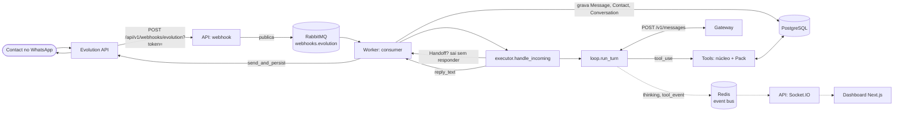

# Arquitetura

Visão do caminho de uma Message do Contact até a resposta do Agent. Os termos (Instance, Turn, Tool, Pack, Handoff…) seguem o [glossário](../CONTEXT.md); as decisões que moldaram o desenho estão nos [ADRs](adr/).

## Processos

O backend roda em dois processos que compartilham Postgres, Redis e RabbitMQ:

- **API** (`app.main:socket_app`): REST sob `/api/v1`, webhook da Evolution e Socket.IO (`/realtime/socket.io`). Só enfileira o webhook; não roda o Agent.
- **Worker** (`backend/scripts/run_worker.py`): consome a fila `webhooks.evolution`, grava Messages e roda o Turn do Agent.

O worker não tem Socket.IO. Os eventos de UI que ele gera (`thinking`, `tool_event`, `human_handoff_requested`) vão para o canal Redis `neuralilux:realtime:events`; a API assina esse canal e os entrega às salas do Socket.IO.

## Fluxo de uma Message

Passo a passo:

1. A Evolution chama `POST /api/v1/webhooks/evolution?token=...`. Sem o token certo a resposta é 401 ([ADR 0006](adr/0006-webhook-token-auth.md)). A rota só publica o evento em `webhooks.evolution` e responde.
2. O consumer (`app/whatsapp/consumer.py`) trata `messages.upsert`, `messages.update`, `connection.update` e `qrcode.updated`. Para `messages.upsert` ele acha a Instance por `evolution_instance_id` (Instance desconhecida é descartada), descarta listas de transmissão (`@broadcast`, log `Broadcast message ignored`) e mensagens invisíveis (protocolo, reação, enquete, edição, chaves de grupo, payload só com `messageContextInfo`) antes de gravar, deduplica pelo `message_id`, cria Contact e Conversation se preciso, abre uma nova Session se o Contact ficou além do limite da Company sem escrever (o Order aberto vira `abandoned`, [ADR 0007](adr/0007-session-de-atendimento.md)) e grava a Message. Um Handoff vencido é devolvido ao Agent aqui, antes do Turn ([operations.md](operations.md#como-o-handoff-termina)).

   **Grupos.** Mensagens de grupo (`@g.us`) são gravadas: o Contact é o próprio grupo, a Conversation tem `is_group=true` e `Message.sender_name` guarda o pushName de quem escreveu (o nome do grupo nunca é sobrescrito por ele). O grupo nunca chega ao Agent (motivo de skip `group`), não abre Session e não entra no Handoff.

   **Histórico.** O webhook só traz o que chega depois da conexão. Os eventos `messages.set`, `chats.set`, `contacts.set`, `chats.upsert` e `connection.update` com `state=open` disparam `app/whatsapp/history_sync.py` numa task de fundo (no máximo uma por Instance). Ele lê `findChats`, `fetchAllGroups`, `findContacts` e todas as páginas de `findMessages`, resolve `@lid` pelo `remoteJidAlt`, deduplica pelo `message_id` e preenche `last_message_*` e `unread_count`. Nunca chama o Agent nem publica evento por Message. `POST /api/v1/conversations/sync?instance_id=` roda a mesma importação sob demanda; `GET /api/v1/conversations/counts` e o filtro `category` alimentam as abas da lista.
3. O Agent só entra se a Message não for `from_me`, não for de `@lid`, não for mais antiga que 5 minutos em relação ao início do worker e a Instance tiver `agent_enabled`. Mídia sem texto recebe uma resposta fixa, sem chamar o Agent.
4. Messages seguidas do mesmo Contact são agrupadas pelo `TurnBatcher`: depois de `DEBOUNCE_SECONDS` (3 s) sem Message nova, roda um Turn só com todas, e o Contact vê "digitando…" enquanto ele dura ([agent.md](agent.md#agrupamento-de-messages-picadas-e-digitando)). `executor.handle_incoming` (`app/agent/executor.py`) lê `human_in_loop` do banco. Em Handoff, o Agent fica em silêncio. Senão monta o contexto (Summary + Recent Window), resolve o Gateway do tipo `whatsapp_agent`, monta o system prompt e as Tools e chama o loop.
5. `loop.run_turn` (`app/agent/loop.py`) chama o modelo, executa os `tool_use` e repete até `end_turn`, uma Tool com `ends_turn` ou `max_steps` ([ADR 0001](adr/0001-own-agent-loop-no-langchain.md)).
6. A resposta passa por `to_whatsapp` (markdown vira formatação do WhatsApp) e `send_and_persist` envia pela Evolution e grava a Message `from_me`. O eco do webhook com o mesmo id é descartado pelo dedup. Depois do envio o consumer avisa os Packs (`on_reply_delivered`): é assim que a Recap só passa a valer depois de o Contact recebê-la.
7. Depois da resposta, o worker agenda `refresh_summary` fora do caminho da resposta ([ADR 0003](adr/0003-memory-window-summary-fts.md)).

Fora desse caminho, a Company usa o painel **Pedidos** (`/pedidos`, `app/api/routes/orders.py` e `app/services/order_status.py`) para mover o status dos Orders; a API envia o aviso ao Contact pelo mesmo `send_and_persist`, e o worker roda o sweeper que devolve ao Agent os Handoffs vencidos ([operations.md](operations.md)).

Detalhes do loop, da memória e dos eventos estão em [agent.md](agent.md).

## Camadas do backend

| Pacote | Papel |
|---|---|
| `app/agent/` | Núcleo genérico: loop, executor, memória, prompts, registry de Tools, Tools do núcleo. Não conhece nenhum Business Type ([ADR 0004](adr/0004-generic-core-business-packs.md)). |
| `app/packs/` | Um Pack por Business Type. Hoje só `catalog_orders`; `registry.py` liga `Business Type.slug` → Pack. |
| `app/llm/` | Cliente do protocolo Anthropic Messages e registry de Gateways ([ADR 0002](adr/0002-anthropic-messages-via-gateways.md)). |
| `app/whatsapp/` | Cliente da Evolution, consumer RabbitMQ, parser de webhook e `sender`. |
| `app/realtime/` | Event bus Redis, Socket.IO e rastreio de eventos de Tool. |
| `app/api/` | `deps.py` (`get_db`, `get_current_user`) e `routes/`, uma rota por assunto. |
| `app/models/`, `app/schemas/` | SQLAlchemy e Pydantic, um módulo por agregado. |
| `app/services/` | Serviços de domínio (companies, menu, pedidos). |
| `app/core/` | Config, banco, segurança, criptografia, logs. |

## Escopo e isolamento

- Toda Tool recebe um `ToolContext` com `company_id`, `instance_id`, `conversation_id`, `contact_id` e `remote_jid`. O `company_id` vem da Instance, nunca de um valor fixo ([ADR 0004](adr/0004-generic-core-business-packs.md)).
- A History Search é sempre limitada ao Contact dentro da Instance.
- Gateways são globais, não por Company. Só superuser os edita ([ADR 0002](adr/0002-anthropic-messages-via-gateways.md)).

## Infra local

Postgres (5434), Redis (6380), RabbitMQ (5672, painel 15672) e Evolution (8081) sobem por Docker. A API e o worker rodam no host. Veja [setup.md](setup.md).
