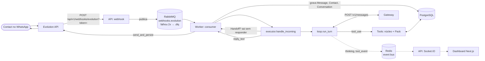

# Arquitetura

Visão do caminho de uma Message do Contact até a resposta do Agent. Os termos (Instance, Turn, Tool, Pack, Handoff…) seguem o [glossário](../CONTEXT.md); as decisões que moldaram o desenho estão nos [ADRs](adr/).

## Processos

O backend roda em dois processos que compartilham Postgres, Redis e RabbitMQ:

- **API** (`app.main:socket_app`): REST sob `/api/v1`, webhook da Evolution e Socket.IO (`/realtime/socket.io`). Só enfileira o webhook; não roda o Agent.
- **Worker** (`backend/scripts/run_worker.py`): consome a fila `webhooks.evolution`, grava Messages e roda o Turn do Agent.

O worker não tem Socket.IO. Os eventos de UI que ele gera (`thinking`, `tool_event`, `human_handoff_requested`) vão para o canal Redis `neuralilux:realtime:events`; a API assina esse canal, revalida cada payload contra o schema de `app/realtime/events.py` e o entrega à sala certa do Socket.IO: `instance:{instance_id}` ou `conversation:{conversation_id}`. No painel, um único socket pertence ao `RealtimeProvider` do layout `(app)` e reconecta sem limite de tentativas ([agent.md](agent.md#eventos-em-tempo-real)).

## Fluxo de uma Message

Passo a passo:

1. A Evolution chama `POST /api/v1/webhooks/evolution?token=...`. Sem o token certo a resposta é 401 ([ADR 0006](adr/0006-webhook-token-auth.md)). A rota só publica o evento em `webhooks.evolution` e responde.
2. O consumer (`app/whatsapp/consumer.py`) trata `messages.upsert`, `messages.update`, `connection.update` e `qrcode.updated`. Para `messages.upsert` ele acha a Instance por `evolution_instance_id` (Instance desconhecida é descartada), descarta listas de transmissão (`@broadcast`, log `Broadcast message ignored`) e mensagens invisíveis (protocolo, reação, enquete, edição, chaves de grupo, payload só com `messageContextInfo`) antes de gravar, deduplica pelo `message_id`, cria Contact e Conversation se preciso, abre uma nova Session se o Contact ficou além do limite da Company sem escrever (o Order aberto vira `abandoned`, [ADR 0007](adr/0007-session-de-atendimento.md)) e grava a Message. Um Handoff vencido é devolvido ao Agent aqui, antes do Turn ([operations.md](operations.md#como-o-handoff-termina)).

   **Grupos.** Mensagens de grupo (`@g.us`) são gravadas: o Contact é o próprio grupo, a Conversation tem `is_group=true` e `Message.sender_name` guarda o pushName de quem escreveu (o nome do grupo nunca é sobrescrito por ele). O grupo nunca chega ao Agent (motivo de skip `group`), não abre Session e não entra no Handoff.

   **Histórico.** O webhook só traz o que chega depois da conexão. Os eventos `messages.set`, `chats.set`, `contacts.set`, `chats.upsert` e `connection.update` com `state=open` disparam `app/whatsapp/history_sync.py` numa task de fundo (no máximo uma por Instance). Ele lê `findChats`, `fetchAllGroups`, `findContacts` e `findMessages` página a página, em duas passadas: a primeira só resolve `@lid` pelo `remoteJidAlt` e coleta os pushNames, a segunda grava cada página (deduplica pelo `message_id`) e preenche `last_message_*` e `unread_count` num `UPDATE` em lote. Nunca acumula o histórico inteiro na memória, mas **cada página é baixada duas vezes** a cada importação (a cada reconexão); uma passada única fica como evolução futura. Nunca chama o Agent nem publica evento por Message. `POST /api/v1/conversations/sync?instance_id=` roda a mesma importação sob demanda; `GET /api/v1/conversations/counts` e o filtro `category` alimentam as abas da lista.
3. Ao gravar, o consumer decide se a Message tem Turn (`turn_state.skip_reason`, a única definição das regras estáticas): não pode ser de grupo, `from_me`, de `@lid` nem mais antiga que 5 minutos em relação ao início do worker. A que tem Turn nasce `turn_state = pending`; a que não tem fica `skipped` com o motivo (grupo e `from_me` ficam sem estado). Em seguida o consumer **confirma a entrega ao RabbitMQ**: o Turn roda fora dela, numa task do `TurnRunner` (`app/whatsapp/turn_runner.py`), então um modelo lento nunca segura o `prefetch`. O Agent só entra se a Instance tiver `agent_enabled`, houver Agent ativo e a Message tiver texto. Mídia sem texto recebe uma resposta fixa, sem chamar o Agent.
4. Messages seguidas do mesmo Contact são agrupadas pelo `TurnBatcher`: depois de `DEBOUNCE_SECONDS` (3 s) sem Message nova (ou `DEBOUNCE_MAX_WAIT_SECONDS`, 15 s, desde a primeira), roda um Turn só com todas (no máximo `TURN_CONCURRENCY` Turns por worker falam com o Gateway ao mesmo tempo; a pausa do debounce não ocupa vaga), e o Contact vê "digitando…" enquanto ele dura ([agent.md](agent.md#agrupamento-de-messages-picadas-e-digitando)). `executor.handle_incoming` (`app/agent/executor.py`) lê `human_in_loop` do banco. Em Handoff, o Agent fica em silêncio. Senão monta o contexto (Summary + Recent Window), resolve o Gateway do tipo `whatsapp_agent`, monta o system prompt e as Tools e chama o loop, que tem prazo total, prazo por Tool e orçamento de retry por Turn ([agent.md](agent.md#prazos-e-retries)).
5. `loop.run_turn` (`app/agent/loop.py`) chama o modelo, executa os `tool_use` e repete até `end_turn`, uma Tool com `ends_turn` ou `max_steps` ([ADR 0001](adr/0001-own-agent-loop-no-langchain.md)).
6. A resposta passa por `to_whatsapp` (markdown vira formatação do WhatsApp) e `send_and_persist` envia pela Evolution e grava a Message `from_me`. O eco do webhook com o mesmo id é descartado pelo dedup. Depois do envio o consumer avisa os Packs (`on_reply_delivered`): é assim que a Recap só passa a valer depois de o Contact recebê-la.
7. Depois da resposta, o worker agenda `refresh_summary` fora do caminho da resposta ([ADR 0003](adr/0003-memory-window-summary-fts.md)).

Fora desse caminho, a Company usa o painel **Pedidos** (`/pedidos`, `app/api/routes/orders.py` e `app/services/order_status.py`) para mover o status dos Orders; a API envia o aviso ao Contact pelo mesmo `send_and_persist`, e o worker roda o sweeper que devolve ao Agent os Handoffs vencidos ([operations.md](operations.md)).

### Resposta durável

Garantia: **toda Message do Contact que tem Turn recebe uma resposta ou um motivo registrado de não ter recebido, mesmo se o worker cair**. O estado fica na própria Message (`turn_state`, `turn_reason`, `turn_claimed_at`; migração `0016`):

| `turn_state` | `turn_reason` | Significado |
|---|---|---|
| `pending` | `queued` / `running` / `failed` / `released` | Falta responder. `queued`: esperando o debounce ou uma vaga; `running`: Turn em andamento; `failed`: o Turn falhou, tenta de novo quando a posse vencer; `released`: shutdown cancelou o Turn, retoma na hora. |
| `answered` | `replied` / `no_reply` / `media_reply` / `sent_elsewhere` | Fechada. `sent_elsewhere`: a resposta já tinha saído (Message `from_me` gravada depois que o Turn começou, inclusive o eco do webhook), não é reenviada. |
| `skipped` | `stale`, `handoff`, `agent_disabled`, `no_agent`, `no_text`, `unresolved_lid`, `conversation_gone` | O Agent não responde por regra. |

Colunas em `messages` e não uma tabela à parte: são três colunas nulas sem default (custo de metadado no Postgres 15, sem reescrever a tabela) e o estado nasce na mesma transação que grava a Message; uma tabela à parte pediria um INSERT a mais por Message e um JOIN em toda varredura. O índice parcial `ix_messages_turn_pending` cobre só as pendentes, então fica minúsculo e a varredura não olha o histórico.

- **Posse.** Quem grava a Message é o dono dela (`turn_claimed_at = agora`, `queued`); o dono renova a posse ao começar o Turn (`running`). A posse vale `TURN_CLAIM_LEASE_SECONDS`. Ninguém mais toca numa pendente com posse válida.
- **Recuperação** (`app/whatsapp/recovery.py`), na subida do worker e a cada `TURN_RECOVERY_INTERVAL_SECONDS`: pega as pendentes sem dono (posse vencida, `released` ou nunca tomada). Mais velhas que `TURN_RECOVERY_MAX_AGE_SECONDS` viram `skipped: stale`; as que já foram respondidas (`sent_since`) viram `sent_elsewhere`; Conversation em Handoff vira `skipped: handoff`; o resto passa pelas mesmas regras do consumer (`agent_enabled`, Agent, texto) e as pendentes da mesma Conversation viram **um** Turn, sem nova pausa.
- **Redelivery.** O broker entrega de novo uma Message cujo `ack` se perdeu: o dedup por `message_id` não grava outra vez, mas, se ela estiver `pending` sem dono vivo, retoma o Turn.
- **Vários workers.** Cada Message é tomada por um `UPDATE ... WHERE turn_state = 'pending' AND turn_claimed_at IS <o que viu> RETURNING id` (compare-and-set). Dois workers que tentam ao mesmo tempo: o segundo UPDATE espera o lock da linha, reavalia o WHERE depois do commit do primeiro e não casa nenhuma linha. Vale igual no SQLite dos testes; não precisa de `SKIP LOCKED`. Coberto por testes com Postgres de verdade (`tests/postgres/test_turn_claim.py`). O claim cobre a **mesma** Message; Messages diferentes da mesma Conversation são cobertas pelo lock abaixo.
- **Shutdown** (`SIGTERM`/`SIGINT`, `scripts/run_worker.py`): para de consumir, espera os Turns em voo até `SHUTDOWN_TIMEOUT_SECONDS`, cancela o resto (a Message volta a `pending`/`released`) e só então desconecta.
- **Limites.** (1) Entrega **pelo menos uma vez**: se o worker cair entre o envio pela Evolution e a gravação da Message `from_me` (janela de milissegundos), a resposta sai de novo na recuperação. (2) Resposta enviada sem `id` pela Evolution é gravada com `message_id` NULL e o eco do webhook a reconhece no banco (`sent_echo.adopt_echo`), então também há prova de envio. (3) Um Turn que estoura `TURN_TIMEOUT_SECONDS` responde o fallback e fecha a Message; só falha inesperada deixa `failed`. (4) A posse precisa ser maior que `DEBOUNCE_MAX_WAIT_SECONDS + TURN_TIMEOUT_SECONDS`, senão outro worker pode assumir um Turn que ainda roda.

### Vários workers e locks por Conversation

O claim por Message (#91) não impede dois Turns de Messages **diferentes** da mesma Conversation em réplicas diferentes, cada um sem ver a resposta do outro. O #92 fecha isso com um advisory lock do Postgres por Conversation (`app/core/conversation_lock.py`, lock de sessão, conexões de um pool próprio). Três locks independentes:

| Lock | Chave | Em volta de | Por quê |
|---|---|---|---|
| `turn` | id da Conversation | o Turn inteiro (`TurnRunner._run`): claim, Agent, envio, fechamento | o segundo Turn só começa depois de gravada a resposta do primeiro, então lê o contexto com ela |
| `summary` | id da Conversation | `refresh_summary` | uma réplica por vez resume; as outras pulam. Separado do Turn para o Contact nunca esperar o Gateway do resumo |
| `save` | Instance + JID | gravar uma Message do webhook (`consumer`) e enviar+gravar uma saída (`sender.send_and_persist`) | o eco de uma resposta nunca é lido antes de a saída estar gravada, em qualquer réplica |

Rajada dividida: o Turn que toma o lock `turn` também absorve as Messages `queued` que outra réplica gravou (`TurnRunner._with_foreign`, `turn_state.foreign_queued`), então a rajada vira **uma** resposta; o Turn da outra réplica acha tudo tomado e se descarta. O que chega com um Turn em curso espera o lock e vê a resposta no contexto.

O que vive em memória do worker e quem cobre cada caso:

| Estado em memória | Efeito entre réplicas | Cobertura |
|---|---|---|
| `TurnBatcher` (debounce, grupos) | cada réplica agrupa só o que recebeu | lock `turn` + `_with_foreign` unem a rajada dividida |
| `consumer._locks` (serialização por JID) | não via a outra réplica | **removido**: lock `save` |
| `TurnRunner._queued` / `_running` | só dizem "este processo está com" | a verdade é `turn_claimed_at` (claim do #91) |
| `TurnRunner._missing_agent_logged` | só log | sem efeito |
| `consumer._summarizing` | evita tasks repetidas no processo | lock `summary` |
| `consumer._syncing` | idem para a importação de histórico | `pg_try_advisory_lock` do `history_sync` (já existia) |
| `sender._unmatched_sends` (eco do Agent) | o eco caía em outra réplica e virava atividade de Attendant | **removido**: saída sem id gravada com `message_id` NULL, eco reconhecido no banco (`sent_echo`) |
| sweeper de Handoff | roda em toda réplica | idempotente (`release(..., only_ticket_id)`) |

Sem Postgres (SQLite dos testes e do dev) o lock é um `asyncio.Lock` por chave dentro do processo: não há exclusão entre processos, então SQLite só suporta **um** worker. Coberto por `tests/postgres/test_two_replicas.py` e `tests/postgres/test_advisory_lock.py`. Dimensionamento de conexões e como escalar: [operations.md](operations.md#réplicas-do-worker).

Detalhes do loop, da memória e dos eventos estão em [agent.md](agent.md).

## Camadas do backend

| Pacote | Papel |
|---|---|
| `app/agent/` | Núcleo genérico: loop, executor, memória, prompts, registry de Tools, Tools do núcleo. Não conhece nenhum Business Type ([ADR 0004](adr/0004-generic-core-business-packs.md)). |
| `app/packs/` | Um Pack por Business Type. Hoje só `catalog_orders`; `registry.py` liga `Business Type.slug` → Pack. |
| `app/llm/` | Cliente do protocolo Anthropic Messages e registry de Gateways ([ADR 0002](adr/0002-anthropic-messages-via-gateways.md)). |
| `app/whatsapp/` | Cliente da Evolution, consumer RabbitMQ, parser de webhook e `sender`. |
| `app/realtime/` | Event bus Redis, schemas dos eventos (`events.py`), Socket.IO e rastreio de eventos de Tool. |
| `app/api/` | `deps.py` (`get_db`, `get_current_user`) e `routes/`, uma rota por assunto. |
| `app/models/`, `app/schemas/` | SQLAlchemy e Pydantic, um módulo por agregado. |
| `app/services/` | Serviços de domínio (companies, menu, pedidos). |
| `app/core/` | Config, banco, segurança, criptografia, logs. |

## Escopo e isolamento

- Toda Tool recebe um `ToolContext` com `company_id`, `instance_id`, `conversation_id`, `contact_id` e `remote_jid`. O `company_id` vem da Instance, nunca de um valor fixo ([ADR 0004](adr/0004-generic-core-business-packs.md)).
- A History Search é sempre limitada ao Contact dentro da Instance.
- Gateways são globais, não por Company. Só superuser os edita ([ADR 0002](adr/0002-anthropic-messages-via-gateways.md)).

## Infra local

Postgres (5434), Redis (6380), RabbitMQ (5672, painel 15672) e Evolution (8081) sobem por Docker. A API e o worker rodam no host. Veja [setup.md](setup.md).
