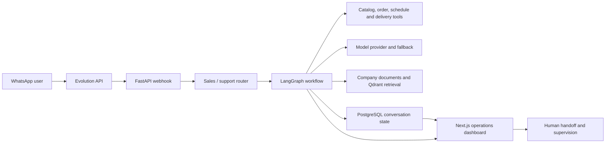

# Neuralilux — reviewer guide

> **30-second summary:** Neuralilux is a product-oriented prototype for AI-assisted WhatsApp operations. It combines multi-tenant account and instance management, conversational agents, operational tools, company-scoped retrieval and a Next.js supervision dashboard.

## Why this project is relevant

Neuralilux is the most directly commercial repository in this portfolio. It addresses a concrete operational problem: companies handling sales and customer support through WhatsApp need consistent responses, catalog/order actions, human handoff and a shared operational dashboard.

The repository demonstrates meaningful product and integration work, but the public snapshot is currently less reproducible and less rigorously validated than Evidrun or OrchestraOS.

## Product flow

## What to inspect

| Surface | Starting point | Review value |
|---|---|---|
| Agent execution | `backend/app/agents/agent_executor.py` | Coordinates a WhatsApp message, graph execution, streaming state and response delivery |
| Agent graph | `backend/app/agents/graph/whatsapp_graph.py` | Encodes handoff, validation, context, intent, tools and response generation |
| Operational tools | `backend/app/agents/tools/` | Connects model decisions to menu, order, schedule and delivery operations |
| Multi-tenant API | `backend/app/api/v1/` | Covers authentication, companies, instances, conversations and configuration |
| Retrieval | `backend/app/rag/` | Ingests and retrieves company-scoped context through Qdrant |
| Data evolution | `backend/alembic/versions/` | Shows progression from messaging to menus, orders, agents, tickets and payments |
| Product interface | `frontend/src/` | Implements instances, conversations, agent settings, inventory and operations views |
| Real-time updates | Socket.IO and event services | Connects backend activity to the supervision interface |

## Strong signals

- The project has a concrete user and workflow rather than an abstract agent framework.
- Agent tools are tied to operational data and actions, not only generic function-calling examples.
- Human handoff is represented in the graph and data model.
- Company rules, documents and vector retrieval acknowledge tenant-specific context needs.
- The frontend covers operational supervision, not merely a chat box.
- Alembic history demonstrates iterative product/domain expansion.

## Material limits

- The public backend snapshot does not include a valid dependency manifest or complete Compose environment.
- `start-backend.sh` references a missing `requirements.txt`, so a clean-clone setup is not reproducible.
- The frontend references a non-versioned `authToken.ts` module.
- There is no active GitHub Actions workflow or current reproducible test report.
- Some RAG and ticket routes still require stronger tenant authorization guarantees.
- Payment and ticket code does not currently prove a complete end-to-end production journey.
- The frontend dependency set and development defaults require modernization before deployment.

## Honest review path

A reviewer can assess architecture and product thinking from the code, but should not assume the full stack can be started from a clean clone today.

Suggested sequence:

1. Read `README.md` and this guide.
2. Inspect `backend/app/agents/graph/whatsapp_graph.py`.
3. Inspect `backend/app/agents/agent_executor.py` and tool modules.
4. Inspect the Alembic migrations to understand the product domain.
5. Inspect `frontend/src/app/` and `frontend/src/components/`.
6. Treat old completion claims as historical until installation and tests are restored.

## Highest-value next milestones

- Restore a locked Python dependency manifest and a minimal Compose environment.
- Restore or replace the missing frontend auth-token module.
- Add a clean-clone smoke test for login, instance connection and one agent conversation.
- Enforce and test tenant boundaries in retrieval, tickets and tool execution.
- Record one safe demo with synthetic data showing WhatsApp input, tool action, dashboard state and human handoff.

## Suggested GitHub topics

`ai-agents`, `whatsapp`, `customer-support`, `sales-automation`, `human-in-the-loop`, `rag`, `langgraph`, `fastapi`, `nextjs`, `qdrant`, `evolution-api`, `multi-tenant`

## Portfolio interpretation

Neuralilux should be used as proof that the author can translate agent concepts into a recognizable business workflow and full-stack interface. It is the best project for a startup-oriented narrative, but it should not be the primary technical-reliability proof until reproducibility, authorization and CI are repaired.
